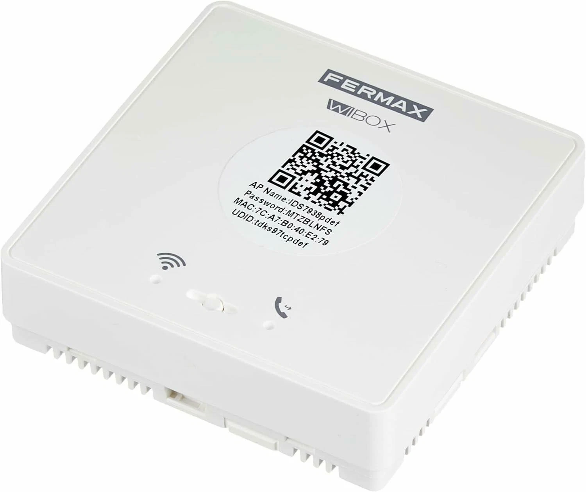

# Wibox Kotlin

Reimplementación Android en Kotlin de los flujos de Wibox (videoportero), construida a partir del análisis de referencias públicas y del APK de fábrica. La arquitectura es provider-neutral: la aplicación no conoce el cloud directamente, solo el puerto `WiboxProvider`, y los límites de cada proveedor se declaran por capacidad en lugar de fingirse soportados.

[Read this in English](README.md).

## Estructura

- `core/cloud`: puerto provider-neutral (`WiboxProvider`), API tipada, modelos de dominio, autenticación OAuth, operaciones Shadow HTTP, `app_upgrade_check` y parsers de eventos con evidencia. No contiene UI.
- `app`: aplicación Android con Jetpack Compose modernizada (32 superficies visuales, 71 aristas de navegación, capturas reales en emulador). Depende de la API pública de `core:cloud` y del módulo `external-api` para el servicio Binder.
- `external-api`: API local Binder/AIDL para que otras apps consulten proveedores Wibox: 15 métodos, 43 modelos, SDK Kotlin main-safe y motor de autorización propio.
- `analysis/rea`, `analysis/apk`, `analysis/dynamic`, `analysis/ui-modernization`, `analysis/final-audit`: inventarios y verificadores con evidencia.
- `docs/protocol.md`, `docs/provider-architecture.md`, `docs/provider-implementation.md`, `docs/external-api.md`, `docs/external-api-implementation.md`, `docs/ui-modernization-evidence.md`: contratos y decisiones con trazabilidad.
- `fastlane`: capturas y metadatos de la aplicación.

## Estado funcional

Adaptador stock QVCloud: solo se implementan operaciones con contrato observado. OAuth (`password`/`refresh_token`), Shadow HTTP (`status`, `multi`, `sub`, `unsub`), alarmas FCM (tipos 2, 19, 20) y `app_upgrade_check`. Alta por invitación con el canal `userauth` real, token de dispositivo, listado unificado, suscripción realtime y CGI local por el túnel del SDK. La vista en vivo abre la cámara por el túnel nativo y habla QUII sobre TCP local.

## Vista en vivo

El camino que funciona es el del SDK del fabricante: se crea el cliente P2P, se espera al servicio UST y se pide el puerto de media con `addPortByP2P`. El SDK lo publica en `127.0.0.1` y ahí se habla QUII: setup de 32 bytes en claro, play con `adminapp2` y la clave derivada del `authCode`, y frames H264 y G711A.

El estado real, lo verificado y lo que sigue pendiente están en [`RELEASE_NOTES.md`](RELEASE_NOTES.md). Resumen honesto: el túnel, el protocolo y la apertura remota funcionan, el timbre rechaza el play con «canal ocupado» buena parte del tiempo (la app oficial dice lo mismo) y despertarlo desde reposo no está resuelto.

El binario nativo del fabricante, sus certificados de cliente y las credenciales del timbre no se versionan. Sin ellos el proyecto compila y arranca, pero no puede abrir túnel. Ver «Requisitos».

Proveedor demo local: implementa los mismos flujos con datos sintéticos etiquetados (`simulated=true`, origen demo) para probar navegación, estados y acciones con ack local honesto.

API externa para otras apps: servicio Binder (`dev.nacho.wibox.externalapi`) con denegación por defecto, autorización por UID + paquete + SHA-256 del conjunto de firmantes con allowlist revocable, handshake obligatorio, límites de tasa y tamaño, y Unsupported honesto heredado de las capacidades del proveedor. Los acks nunca superan lo realmente observado (máximo `LOCAL_ACCEPTED` en demo).

## Hardware

El Wi-Box es un módulo Fermax que se instala detrás del telefonillo y levanta su propio punto de acceso mientras no está emparejado. Todo lo que necesita el alta por red está en la etiqueta de fábrica: nombre del AP, su contraseña, la MAC y el UDID, agrupados además en un QR.



El detalle de esos campos, el orden en que aparecen en el QR y su papel en el registro están en `docs/protocol.md` §14.5. Foto de [segator/wibox-media](https://github.com/segator/wibox-media) (GPL-3.0), copiada sin recodificar.

## Requisitos

- JDK 17.
- Android SDK en `~/Android/Sdk` o configurado mediante `ANDROID_HOME`.
- Platform Android 37.0 y Build Tools 37.0.0.
- Para pruebas instrumentadas, un emulador o dispositivo Android visible mediante ADB.
- Para la vista en vivo, el SDK nativo del fabricante en `app/src/main/jniLibs/arm64-v8a/` y sus certificados de cliente en `app/src/main/assets/`. No se versionan: son propietarios y llevan credenciales de un timbre real.
- Credenciales del timbre en `local.properties` (`wibox.account`, `wibox.password`, `wibox.clientId`, `wibox.unlockPassword`) o en el entorno. También vale aceptar una invitación desde la app, que guarda una cuenta temporal.

`local.properties`, credenciales y tokens no se versionan.

## Comandos

```bash
./gradlew :core:cloud:test :external-api:testDebugUnitTest :app:testDebugUnitTest
./gradlew :app:assembleDebug :app:lintDebug
ANDROID_SERIAL=emulator-5554 ./gradlew :app:connectedDebugAndroidTest
python3 analysis/final-audit/verify_final_audit.py
python3 analysis/final-audit/verify_release.py
```

Los tests usan respuestas simuladas y no contactan con el cloud real. El selector `ANDROID_SERIAL` es obligatorio en tests instrumentados si hay otros dispositivos conectados.

## Verificación

```bash
python3 scripts/verify_architecture.py
python3 analysis/ui-modernization/verify_ui_modernization.py
python3 analysis/external-api-runtime/verify_external_api_runtime.py
python3 analysis/final-audit/verify_final_audit.py
python3 analysis/final-audit/verify_release.py
python3 scripts/verify_project.py
```

La auditoría final cubre 64 capacidades, 38 pantallas y 71 aristas de navegación con límites documentados. La verificación de release comprueba firma, alineación, instalación, arranque y captura de la APK.

## Límites honestos

- Compatibilidad cloud declarada por capacidad: la única operación stock con contrato dinámico observado es `app_upgrade_check`.
- Sin hardware real verificado: llamadas, preview y acciones físicas no están certificadas.
- Realtime, discovery, media y acciones físicas permanecen `Unsupported` hasta disponer de evidencia dinámica autorizada.
- La API externa no expone secretos ni promete operaciones que el proveedor activo no soporte.

## Proyectos relacionados

- [wibox-daemon](https://github.com/gnacho/wibox-daemon): daemon en Go para Linux que abre el timbre por la red local.

