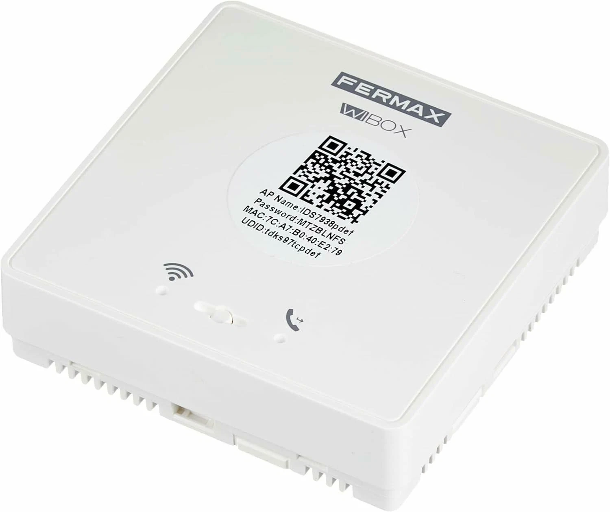

# Wibox Kotlin

Android reimplementation in Kotlin of the Wibox (video intercom) flows, built from the analysis of public references and the factory APK. The architecture is provider-neutral: the application does not know the cloud directly, only the `WiboxProvider` port, and each provider's limits are declared per capability instead of being pretended to be supported.

[Read this in Spanish](README.es.md).

## Structure

- `core/cloud`: provider-neutral port (`WiboxProvider`), typed API, domain models, OAuth authentication, HTTP Shadow operations, `app_upgrade_check` and event parsers with evidence. No UI.
- `app`: Android application with modernized Jetpack Compose (32 visual surfaces, 71 navigation edges, real captures on the emulator). Depends on the public API of `core:cloud` and on the `external-api` module for the Binder service.
- `external-api`: local Binder/AIDL API so other apps can query Wibox providers: 15 methods, 43 models, main-safe Kotlin SDK and its own authorization engine.
- `analysis/rea`, `analysis/apk`, `analysis/dynamic`, `analysis/ui-modernization`, `analysis/final-audit`: inventories and verifiers with evidence.
- `docs/protocol.md`, `docs/provider-architecture.md`, `docs/provider-implementation.md`, `docs/external-api.md`, `docs/external-api-implementation.md`, `docs/ui-modernization-evidence.md`: contracts and decisions with traceability.
- `fastlane`: screenshots and app metadata.

## Functional status

Stock QVCloud adapter: only operations with an observed contract are implemented. OAuth (`password`/`refresh_token`), HTTP Shadow (`status`, `multi`, `sub`, `unsub`), FCM alarms (types 2, 19, 20) and `app_upgrade_check`. Pairing by invitation with the real `userauth` channel, device token, unified listing, realtime subscription and local CGI through the SDK tunnel. The live view opens the camera through the native tunnel and speaks QUII over local TCP.

## Live view

The path that works is the manufacturer SDK's: the P2P client is created, the UST service is awaited and the media port is requested with `addPortByP2P`. The SDK publishes it on `127.0.0.1` and QUII is spoken there: 32-byte plaintext setup, play with `adminapp2` and the key derived from the `authCode`, and H264 and G711A frames.

The real state, what has been verified and what is still pending are in [`RELEASE_NOTES.md`](RELEASE_NOTES.md). Honest summary: the tunnel, the protocol and remote opening work, the doorbell rejects the play with "channel busy" a good part of the time (the official app says the same) and waking it from sleep is not solved.

The manufacturer's native binary, its client certificates and the doorbell credentials are not versioned. Without them the project builds and starts, but it cannot open a tunnel. See "Requirements".

Local demo provider: implements the same flows with labelled synthetic data (`simulated=true`, demo origin) to test navigation, states and actions with an honest local ack.

External API for other apps: Binder service (`dev.nacho.wibox.externalapi`) with denial by default, authorization by UID + package + SHA-256 of the signer set with a revocable allowlist, mandatory handshake, rate and size limits, and honest Unsupported inherited from the provider capabilities. Acks never exceed what was actually observed (at most `LOCAL_ACCEPTED` in demo).

## Hardware

The Wi-Box is a Fermax module installed behind the door phone that brings up its own access point while it is not paired. Everything the network pairing needs is on the factory label: the AP name, its password, the MAC and the UDID, also grouped in a QR code.



The detail of those fields, the order in which they appear in the QR code and their role in registration are in `docs/protocol.md` §14.5. Photo from [segator/wibox-media](https://github.com/segator/wibox-media) (GPL-3.0), copied without re-encoding.

## Requirements

- JDK 17.
- Android SDK in `~/Android/Sdk` or configured through `ANDROID_HOME`.
- Android platform 37.0 and Build Tools 37.0.0.
- For instrumented tests, an emulator or Android device visible through ADB.
- For the live view, the manufacturer's native SDK in `app/src/main/jniLibs/arm64-v8a/` plus the client certificate and key in `app/src/main/assets/` (`client.pem`, `client.txt`). They are not versioned: they are proprietary and the key belongs to the vendor. The Qualvision root CA is versioned as `assets/ca.pem` and reused for the SDK, so no `qv_ca.pem` copy is needed. Without them the app runs on the pure Kotlin path and reports it once in the log.
- Doorbell credentials in `local.properties` (`wibox.account`, `wibox.password`, `wibox.clientId`, `wibox.unlockPassword`) or in the environment. Accepting an invitation from the app also works, which stores a temporary account.

`local.properties`, credentials and tokens are not versioned.

## Commands

```bash
./gradlew :core:cloud:test :external-api:testDebugUnitTest :app:testDebugUnitTest
./gradlew :app:assembleDebug :app:lintDebug
ANDROID_SERIAL=emulator-5554 ./gradlew :app:connectedDebugAndroidTest
python3 analysis/final-audit/verify_final_audit.py
python3 analysis/final-audit/verify_release.py
```

The tests use simulated responses and do not contact the real cloud. The `ANDROID_SERIAL` selector is mandatory in instrumented tests when other devices are connected.

## Verification

```bash
python3 scripts/verify_architecture.py
python3 analysis/ui-modernization/verify_ui_modernization.py
python3 analysis/external-api-runtime/verify_external_api_runtime.py
python3 analysis/final-audit/verify_final_audit.py
python3 analysis/final-audit/verify_release.py
python3 scripts/verify_project.py
```

The final audit covers 64 capabilities, 38 screens and 71 navigation edges with documented limits. The release verification checks signing, alignment, installation, startup and APK capture.

## Honest limits

- Cloud compatibility declared per capability: the only stock operation with an observed dynamic contract is `app_upgrade_check`.
- No verified real hardware: calls, preview and physical actions are not certified.
- Realtime, discovery, media and physical actions remain `Unsupported` until authorized dynamic evidence is available.
- The external API does not expose secrets and does not promise operations that the active provider does not support.

## Related projects

- [wibox-daemon](https://github.com/gnacho/wibox-daemon): Go daemon for Linux that opens the doorbell over the local network.

## License

GNU Affero General Public License v3.0. See [LICENSE](LICENSE).
