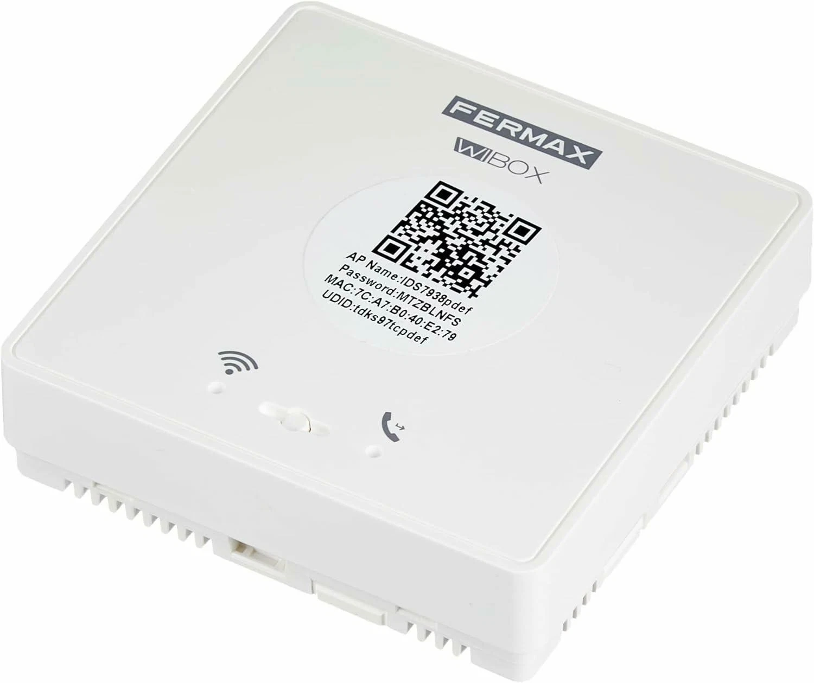

# Wibox cloud protocol

## 1. Scope and level of certainty

This document describes the contract implemented in `core:cloud` from the Wibox Fermax v2.2 APK, package `com.fermax.wibox`, version 18 and SHA-256 registered in `analysis/apk/inventory.json`. The static evidence is complemented with the authorized attempt3 capture of `analysis/dynamic/inventory.json`. The implementation and its tests have not contacted services and full cloud compatibility is not claimed.

The public API is in `core/cloud/src/main/kotlin/dev/nacho/wibox/core/cloud/WiboxCloud.kt`. Consumers use `WiboxCloudFactory.create`, models of the `dev.nacho.wibox.core.cloud` package, `TokenStore` and `CloudClock`. No public type belongs to Ktor. Transport, DTOs and parsers are in `dev.nacho.wibox.core.cloud.internal`.

The tests use `MockEngine`, injected clock and storage, fictional fixtures and the reserved host `unit.test`. They do not use the network.

## 2. Evidence, implementation and limits matrix

| ID | Evidence | Operation | Implemented state | Main test | Limitation |
|---|---|---|---|---|---|
| P-OAUTH-PASSWORD | E029, E033, `OAuthApi.java`, `GetTokenResp.java` | `authenticate` | Implemented with GET and password grant | `OAuthContractTest.passwordGrantUsesExactWireContractAndPersistsSession` | Requires opaque credentials already obtained. It does not create an account or a login screen |
| P-OAUTH-REFRESH | E033 to E036, `QvOAuthManager.java` | `refreshSession` and refresh prior to Shadow | Implemented with refresh grant and a five-minute margin | `OAuthContractTest.refreshGrantUsesOnlyRefreshQueryAndAccessTokenHeader`, `SessionBehaviorTest.concurrentRefreshUsesSingleFlightAndOnePersistenceWrite` | Without retained credentials there is no implicit fallback to password |
| P-SESSION-RESTORE | E034, E036 | `restoreSession`, cache and persistence | Implemented through `TokenStore` | `SessionBehaviorTest.restoresOnceAndUsesFreshCachedAccessToken` | Encryption and persistent atomicity depend on the `TokenStore` implementation |
| P-SHADOW-STATUS | E041, `QvShadowApi.java`, `QvShadowHttpManager.java`, Shadow entities | `getDeviceShadow` | Implemented | `ShadowContractTest.statusUsesPostTokenHeaderAndTypedBody` | State integers are kept without translating unproven semantics |
| P-SHADOW-MULTI | E041, `QvShadowApi.java`, Shadow entities | `getDeviceShadows` | Implemented | `ShadowContractTest.multiStatusUsesArrayBodyAndPreservesMissingState` | It does not infer missing devices nor pagination |
| P-SHADOW-SUB | E041, `QvShadowApi.java`, `QvShadowSubscribeRequest.java` | `subscribeDeviceShadows` | Implemented only for `Device_state` | `ShadowContractTest.subscribeUsesDeviceStateSubscriptionAndReturnsAck` | The HTTP ack does not open MQTT nor prove later delivery |
| P-SHADOW-UNSUB | E041, `QvShadowApi.java`, `QvShadowUnsubscribeRequest.java` | `unsubscribeDeviceShadows` | Implemented with reasons 1 and 2 | `ShadowContractTest.unsubscribeUsesReasonAndEmptyFieldsAndReturnsAck` | It does not revoke the session nor physically unbind the device |
| P-ALARM-FCM | E056, E057, `AlarmMessageInfo.java` | `parseAlarmEvent` | Offline parser for motion, call and answered call | `EventAndUnsupportedTest.parsesDocumentedAlarmTypesAndPreservesUnknownFields` | It does not register FCM nor interpret the date format |
| P-APP-UPGRADE | E050 and `DYN3-HTTP-UPGRADE-001` in attempt3 | `checkAppUpgrade` | Implemented only for the observed GET and HTTP 200 XML success | `UpgradeContractTest.requestMatchesAttempt3AndParsesEveryObservedField` | No update-available decision, error contract or total cloud compatibility |
| P-ERROR-HTTP | E035 and HTTP behaviour observed statically | 401, 403 and remaining errors | Typed errors and no automatic retry | `ErrorAndSafetyTest.mapsHttpErrorsWithoutRetryOrSecretLeakage` | No provider error envelope is invented |
| P-ERROR-WIRE | OAuth and Shadow DTOs | Network, timeout, parsing and incomplete response | Typed errors without false state | `ErrorAndSafetyTest` | There are no retries nor ambiguous recovery |
| U-SERVICE-DISCOVERY | E034, E040 and `QvLocationManager` | `discoverServices` | `Unsupported` | `EventAndUnsupportedTest.capabilitiesAndUnsupportedOperationsNeverClaimRuntimeSupport` | Dynamic discovery is not solved |
| U-DEVICE-LIST | E004, E010, E020, section 16 of this document | `listDevices` | Implemented over the account directory injected by the owner of the userauth session (`get-device-list`) | `RealCloudWiringTest.listDevicesMapsTheAccountDirectoryAndDropsInvalidIdentifiers` | The account session and its cookie belong to the app. An unwired directory answers `Unsupported`, never an empty catalogue |
| U-REALTIME | E037 to E041, E048, E056, E063, E073 | `observeEvents` | Stream fed with decoded push payloads, each one parsed by `parseAlarmEvent` | `RealCloudWiringTest.observeEventsEmitsParsedPushPayloadsAndSkipsUnknownOnes` | The vendor MQTT shadow is disabled by default and this app has no push receiver yet, so without an injected source the stream stays empty |
| U-ACTIONS | E019, E023, E025 | `performAction` | Delegated to the injected transport, wired to the QUII live session for unlock (transparent command 4) | `RealCloudWiringTest.performActionDelegatesToTheInjectedTransportAndKeepsItsCode` | F1 and the guard call have no verified transport, and this code does not prove the physical opening |
| U-REGISTER | E004, E010, smali `com.quvii.qvweb.userauth` | Opaque registration and `userLogin` | Contract closed by smali, without an exposed operation | Section 14 and documentation | Real gateway response pending capture, the reference app never got to send the POST due to the TLS block |
| U-MEDIA | E011, E021, E023, E042 | Audio and video | Not implemented | Capability review | Native P2P not reimplemented and original binaries forbidden |

`CloudCapabilities` only announces OAuth password, OAuth refresh, HTTP Shadow, offline alarm parser and app upgrade check. The other capabilities are outside the supported set.

## 3. Configuration and service discovery

`WiboxCloudConfig.baseUrl` is mandatory and has no default value. It must be HTTPS, have a host, and not include userinfo, query or fragment. The factory does not contain a production endpoint nor a real test one. The caller must provide an already resolved base for OAuth and Shadow.

`discoverServices` returns `CloudError.Unsupported`. Regional URLs depend on `QvLocationManager` and P2P according to E034 and E040. The analysis has not resolved the dynamic response that assigns services 4 and 8, so it is not replaced by the bootstrap host or by a historical IP.

Request, connection and socket timeouts are configurable and positive. Engine redirects and connection retry are disabled. TLS uses the platform's normal certificate and hostname validation, with no own trust store or exceptions.

## 4. OAuth

### 4.1 Password grant

Request:

```text
GET /qvoauthv2/token
token: <previous access token or empty string>
```

Query in this order:

```text
grant_type=password
client_id=<config>
client_type=<config>
oemid=<config>
appid=<config>
usr=<opaque account>
pwd=<secret of that account>
region_id=<config>
client_flag=<config>
```

The values are encoded as URL query. `Authorization` and the Bearer scheme are not used. The `token` header is always sent. In an initial authentication it is an empty string, and if there is a restored session it contains its previous access token. This local rule avoids the absence of the header required by the integration contract without turning the password grant into Bearer authorization.

Supported response:

```json
{
  "access_token": "<JWT>",
  "refresh_token": "<JWT>"
}
```

Additional JSON fields are tolerated. Both tokens are mandatory. Each one must have three segments, a Base64URL JSON payload and a positive numeric `exp`. Only the expiry is decoded to manage the session. Identity and authorization validation belongs to the server and the TLS channel, not to an invented local signature verification.

### 4.2 Refresh grant

```text
GET /qvoauthv2/token?grant_type=refresh_token&refresh_token=<token>
token: <current access token>
```

The response requires complete access and refresh tokens and replaces both atomically with respect to `TokenStore`. A valid response without a refresh token is `CloudError.Parse` and does not overwrite the previous session.

### 4.3 Margin, single-flight and persistence

A token is usable only if `exp - clock > 300000 ms`. At the exact five-minute limit it is renewed. If the access token is within the margin but the refresh token is usable, a Shadow operation shares a single renewal in flight. Concurrent callers receive the same result and there is a single request and a single `save`.

`refreshSession` forces a refresh, while Shadow operations reuse a fresh access token. User and password are not stored for a hidden second authentication. If both tokens stop being usable, `CloudError.MissingToken` occurs before the network.

`TokenStore` defines suspending `load`, `save` and `clear`. The app must provide encrypted storage and atomic writes. The library does not offer an insecure persistent store. `CloudSession.toString` and `CloudCredentials.toString` redact secrets, and errors do not incorporate bodies, URLs or potentially sensitive transport messages.

## 5. HTTP Shadow

The four operations use POST, JSON, the `token` header with the access token and no query parameters. A business response is only accepted with `code=0`. A different code produces `CloudError.Provider` with the numeric code, without copying server messages.

### 5.1 Single status

Route `/openapi-tdk/device/status`.

```json
{
  "thingId": "fixture-device-001",
  "fieldNames": ["Device_state"]
}
```

The response requires `data.thingId` and `data.fields`. `Device_state` can be null. The typed fields are `F1_state`, `Switch_state`, `Private_mode_state`, `Fisheye_chn_state`, `Lock_state`, `Alarm_zone_mode` and `Smart_relay`. The public models use Kotlin names and keep the original integers. Unknown fields of state, switches, locks, relays and `fields` are kept as JSON in `unknownFields`. Unknown envelope fields are kept in `responseUnknownFields`.

### 5.2 Multiple status

Route `/openapi-tdk/device/status/multi`. The body is an array of `thingId` and `fieldNames` objects. The `data` response is an array in the same model. Missing states are not filled in and `Device_state=null` is not turned into online, offline or action success.

### 5.3 Subscription

Route `/openapi-tdk/device/status/sub`.

```json
{
  "appId": "2021",
  "clientId": "fixture-client",
  "subData": [
    {"thingId": "fixture-device-001", "fieldNames": ["Device_state"]}
  ]
}
```

Only `Device_state` is requested, the field seen in the producer. The ack requires `code=0`, `path` and `timestamp`, keeps optional `data` and unknown envelope fields. It does not imply that an active event channel exists.

### 5.4 Unsubscription

Route `/openapi-tdk/device/status/unsub`. It uses the same envelope with `subData`. Each entry carries `fieldNames=[]` and `doType`: 1 for `ACCOUNT_LOGOUT`, 2 for `DEVICE_UNBIND`. These are the values present in the APK entities. No OAuth revocation or physical unbinding semantics are added to them.

## 6. Events and alarms

`parseAlarmEvent` processes a `Map<String, String>` already received by the caller. It recognises `AlarmEvent=2` as motion, 19 as incoming call and 20 as answered call. It models `AlarmId`, `DevUmid`, `SensorChNo`, `CameraName`, `NotReadCount`, `AlarmEvent` and `AlarmTime` according to E056 and `AlarmMessageInfo`.

`AlarmEvent` and `NotReadCount` must be integers. A missing or non-numeric `SensorChNo` is represented as -1, same as the static parser. The date is kept as text because neither zone nor full format has been fixed. Other fields are kept. An unknown alarm code produces `Unsupported`, and an invalid mandatory integer produces `Parse`.

`observeEvents` does not open a socket and does not simulate events. It returns a stream fed with the push payloads injected by the owner of the push transport, and each payload goes through `parseAlarmEvent`, so an unknown alarm code is skipped and a known one is emitted. Without an injected source the stream stays empty. The vendor MQTT shadow remains disabled and is not used.

## 7. Errors and retries

| Error | Condition |
|---|---|
| `MissingToken` | There is no session or access and refresh do not exceed the margin |
| `Authentication` | HTTP 401 |
| `Authorization` | HTTP 403 |
| `Http` | Another non-2xx status |
| `Provider` | Shadow response with `code` other than 0 |
| `Network` | Non-temporary transport failure |
| `Timeout` | Request or socket timeout |
| `Parse` | Invalid JSON, invalid JWT or incomplete mandatory fields |
| `Persistence` | `TokenStore.load` or `save` failure |
| `InvalidInput` | Invalid configuration, credentials or IDs |
| `Unsupported` | Operation or event without an implemented contract |
| `Closed` | Operation after close |

No Ktor retry is installed and the engine does not retry connection failures. In particular, 401, 403, invalid JSON and network errors generate a single request. Physical actions do not reach the network, so an ambiguous action is never repeated. Action success is not reported without ack, and the subscription ack is not presented as physical confirmation.

`close` cancels its own scope and closes the HTTP client. It is idempotent and does not delete or revoke tokens.

## 8. Unresolved dynamic service discovery

Regional selection and obtaining OAuth, Shadow and MQTT services require the dynamic result of `QvLocationManager`. The schema of that response and its runtime correlation are missing. Therefore there is no hidden bootstrap nor fallback to historical hosts. The injected base URL is deliberate and visible in the configuration. This separation allows testing the known operations without claiming that endpoint provisioning is finished.

## 9. MQTT disabled

The APK contains Paho, topics, QoS 1, heartbeat and reconnection, but `SUPPORT_DEVICE_SHADOW=false` prevents initialization by default according to E063 and E073. The Paho classes are not complete in the JADX output. No MQTT client, connection, heartbeat or replay is implemented. The HTTP subscription does not activate MQTT and `observeEvents` is fed by push payloads, not by this channel.

## 10. Native P2P not reimplemented

Stock video and audio depend on native P2P tunnels, mapped ports and URLs with credentials. No original libraries, `quii` URLs, SIP, WebSocket, WebRTC or a fake player are included. `MEDIA_P2P` is not supported and physical actions return `Unsupported`.

## 11. Differences with duhow and cmos486

duhow documents UART, local CGI and MQTT of patched firmware. Its topics, commands and responses are not mixed with the APK's OAuth or Shadow. The CGI ack or a local publish does not prove physical opening either. This module does not adopt default credentials, plain channels or timed sequences from that firmware.

cmos486 describes another custom firmware with RTSP, WebRTC and MQTT. Those features do not prove the stock transport and are not reused as a cloud contract. Configurations, secrets or native components are not copied either. REA is used only as an analysis tool, never as a protocol reference.

## 12. Evidence that requires authorized capture

- Dynamic service discovery response and association of regional services.
- Runtime OAuth requests and responses, including provider errors and real rotation.
- Shadow responses per version and semantics of each state integer.
- Confirmation that subscribing over HTTP yields events and from which channel, order, duplicates and gaps.
- Complete contract of `userFreeRegister`, `userLogin`, device list and dynamic credentials.
- `AlarmTime` format and zone, FCM deduplication and background behaviour.
- Physical commands, correlation and ack that distinguishes accepted sending from physical effect.
- P2P wire format and FOSS media alternative without loading original binaries.
- Non-200 upgrade responses, provider errors, update decision semantics and strict production TLS behaviour.

Until those captures are available, the corresponding operations remain unexposed or will return `Unsupported`.

## 13. App upgrade check observed in attempt3

`DYN3-HTTP-UPGRADE-001` provides the request and HTTP 200 XML success. The observed host and port remain in the evidence inventory and are not copied as client defaults. `AppUpgradeRequest.baseUrl` is mandatory and passes the same strict HTTPS validation as the rest of the client. `currentVersion` and `clientId` are explicit. The stock appid is 2021 and the path is `/webs/version/app/version_check.jsp`.

```text
GET <upgrade-base>/webs/version/app/version_check.jsp
Accept-Language: en-US

os=android&appid=2021&version=<currentVersion>&clientid=<clientId>
```

No `token`, `Authorization`, body or cookies are sent. Query values are URL encoded. Only HTTP 200 and `Content-Type: text/xml;charset=UTF-8` are accepted, normalizing spaces and case. Another Content-Type produces `CloudError.Parse` and another status produces the existing typed HTTP error. An unobserved error contract is not claimed.

`AppUpgradeInfo` contains `flag`, `result`, `priority`, `version`, `url`, `description`, `configVersion`, `configUrl` and `configPicture`. It does not contain an `updateAvailable` decision. Empty URLs and descriptions are returned as empty strings. A `result` other than 0 produces `CloudError.Unsupported`, never a partial success.

The parser uses JDK DOM available on Android, without a new dependency. It limits the document to 64 KiB, rejects DOCTYPE, entity declarations and XInclude, disables entity expansion and external access to DTDs and schemas, and validates all required elements and integers. Failures produce `CloudError.Parse` without including the XML or partial states.

The `Set-Cookie` headers are ignored. No cookie store is installed, they are not forwarded in later calls and this operation does not read or write `TokenStore`. `AppUpgradeRequest.toString` redacts clientId and base URL, and there is no BODY logging.

The `ssl_insecure` exception in attempt3 belonged exclusively to the laboratory MITM proxy due to an expired upstream. It has not been copied to the client. TLS keeps certificate and hostname validation.

Bind, device list, media and physical actions still lack sufficient request and response and remain unexposed or `Unsupported`. Registration and login now have the complete static contract of section 14, without a real response capture. OAuth and Shadow keep their static scope, without a claimed runtime validation.

## 14. Registration and login: userauth contract observed in smali and verified against the server

The evidence comes from the static analysis of the official stock APK (`com.quvii.qvweb.userauth`) and from real traffic captured on 2026-11-01. TLS interception of the `r1` hosts was achieved by patching the SDK's own pinning (see 14.1), with the channel open, a synthetic POST obtained a real server response with the exact format the smali declared. The reference app still has not sent the POST by itself: its pairing wizard requires the physical doorbell.

### 14.1 Endpoint and transport

Sending uses POST against `{baseUrl}/auth/user;jus_duplex=up` with `Content-Type: application/xml;charset=utf-8` and `User-Agent: okhttp/3.9.0`. The `baseUrl` is provided by `DownChannelManager` (`https://host:port/`), the gateway served is `https://r1-8.qvcloud.net:443/`. Two requirements verified with real traffic:

- **Mandatory session cookie**: without `Cookie: jsessionid=...` the gateway responds plain nginx 404. With the cookie of the app's down channel session, the same POST returns 200. The SDK method is called `getAuthInstanceWithCookie`, consistent with this requirement.
- **Duplex pattern**: the `jus_duplex=up` POST returns 200 with an empty body, the response arrives through the downlink `GET /auth/nologin;jus_duplex=down` of the SAME session, a long-poll that renews every ~30 s. The server issues the session with `Set-Cookie: jsessionid=...` in the first 200 of the down channel. Other channel commands use `/auth/nologin;jus_duplex=up` and `/auth/user/deli;jus_duplex=up`.

The SDK's TLS pinning is in `OkHttpUtil.initSSL()` (private static method): `KeyStore BKS` with password `123456` loaded from the `client.bks` assets (client key, potential mTLS) and `server.bks` (truststore with the Qualvision CA), consumed by `createBuilder2()` that uses the auth flow. That pinning is the reason mitmproxy was rejected with `certificate_unknown` on `r1-*` despite the installed user CA and the native OpenSSL patches. The embedded root CA is `assets/ca.pem` (QUALVISION TECHNOLOGY CO.,LTD, 2017-2037).

### 14.2 Request envelope

The body is XML serialized with simpleframework, root `envelope` without strict mode, with two blocks:

```xml
<?xml version="1.0" encoding="UTF-8"?>
<envelope>
  <header>...</header>
  <content>...</content>
</envelope>
```

`header` header:

| Field | Registration (`userFreeRegister`) | Login (`userLogin`) |
|---|---|---|
| `flag` | `tdkcloud` | `tdkcloud` |
| `version` | value served by version_check, observed `5.1.11`, not fixed | same |
| `command` | `dev-bind-register` | `login` |
| `seq` | `0` | `0` |
| `session` | empty | empty |
| `userData` | `authEncWay` | empty |
| `client` | `id`, `type`, `oem`, `app` | same |

The `client` block carries `id` with the FCM push token, `type` with `3`, `oem` with `G0021` and `app` with `2021`. The `clientid` format observed in version_check is `003-2021-` followed by a random hexadecimal identifier of 16 characters.

Registration `content` (constructor with five fields): `deviceId` with the umid, `deviceName`, `password`, `authCode` and `authEncWay` with value `sha2-256` or `plain`. The real `bindDevRegister` flow generates the password with a random UUID, takes `authCode` from the physical doorbell QR code and sets `authEncWay` to `sha2-256`: it is registration with device binding, not account creation free of hardware.

Login `content` (constructor with five fields): `account`, `password`, `type`, `autchCode` (with this misspelling on the wire) and `ipRegionId` with the current IP region.

### 14.3 Real observed response

Captured on 2026-11-01 on the down channel of the stock app, in response to a synthetic POST authenticated with the channel session:

```xml
<?xml version="1.0" encoding="UTF-8"?>
<envelope>
  <header>
    <flag>tdkcloud</flag>
    <version>v1.24</version>
    <command>dev-bind-register</command>
    <seq>0</seq>
    <result>100009</result>
  </header>
  <content>
    <account></account>
    <dynamic-password></dynamic-password>
    <password-expired></password-expired>
    <data-encode-key></data-encode-key>
    <is-default-out-authcode>0</is-default-out-authcode>
    <default-out-auth-code></default-out-auth-code>
  </content>
</envelope>
```

Wire observations: the protocol version the server declares in the response is `v1.24` (different from the client's `5.1.11`), the server delivered the same response twice (duplicate of the message in two long-poll cycles), the element names (`dynamic-password`, `data-encode-key`, `is-default-out-authcode`) match 1:1 the fields of the smali's `UserFreeRegisterResp$Content` except for name normalization. A non-zero `result` is interpreted as an error, `100009` does not appear as a constant in the client (defined only on the server).

Real `login` response (same day, POST with `account`=UDID from the device label and the device password, rejected):

```xml
<envelope>
  <header>
    <flag>tdkcloud</flag><version>v1.24</version>
    <command>login</command><seq>0</seq><result>100009</result>
  </header>
  <content>
    <account-id>0</account-id><nick></nick><expire>0</expire>
    <token></token><is-guest>0</is-guest><mfa-status>0</mfa-status><mfa-ttl>0</mfa-ttl>
  </content>
</envelope>
```

That `dev-bind-register` and `login` return the same `100009` points to a generic error code (parameters or session), not to a specific credential rejection. The UDID on the label does not work as a login `account`: the account is the one the app registration creates, not the device.

### 14.4 Limits

The registration success case has not been observed. The sequence of real attempts (all with `result=100009`): synthetic deviceId hex8 and hex16 with empty authCode, login with `account`=UDID from the label and device password, `dev-bind-register` with the real UDID `<UDID>` and `authCode=<AP_PASSWORD>` in `plain`, the same with `client.id`=real FCM token extracted from the app prefs, own fresh session of the `/auth/user` channel (full duplex controlled by curl, response received directly on our own down), and `authCode=SHA-256(<AP_PASSWORD>)` with `authEncWay=sha2-256` (the real encryption is `QvEncrypt.EncodeDevicePassword`: if the string has 64 or more characters it is returned as is, otherwise SHA-256). The label QR code decodes to `<AP_SSID> <UDID> <AP_PASSWORD> IDS7938 <MAC>`: it does not carry a separate authCode field, the authCode of the flow is the AP password from the QR code itself.

Since the server returns the same `100009` for non-existent deviceIds and for the real device (which is bound to the user's account), the most plausible hypothesis is a generic registration rejection, with "device already bound to another account" being the explanation pending confirmation, ruling it out would require unbinding the doorbell from the real account (destructive action not authorized). The app does not offer a login screen or independent registration: account creation is 100% tied to the pairing of a physical device. The operation is still not exposed in the public API of `core:cloud`.

### 14.5 The device label

All the data the network pairing asks for comes from the label stuck on the back of the module. They are not on any screen of the factory app nor can they be deduced from the rest of the protocol: they have to be read from the device.



The label has four lines and a QR code that groups them:

- `AP Name`: name of the access point the module brings up while it is not paired.
- `Password`: password of that access point. It is also the `authCode` of the registration, as explained in the previous section.
- `MAC`: MAC of the module WiFi.
- `UDID`: device identifier.

In the following table, the values of the photographed unit, which is a different device from the unit used in the captures of section 14 (that one has AP `<AP_SSID>` and UDID `<UDID>`):

| Field | Value |
|---|---|
| AP Name | `IDS7938pdef` |
| Password | `MTZBLNFS` |
| MAC | `7C:A7:B0:40:E2:79` |
| UDID | `tdks97tcpdef` |

The QR code decodes (checked with `zbarimg --raw`) to `IDS7938pdef tdks97tcpdef MTZBLNFS IDS7938 7CA7B040E279`, that is, five space-separated fields in the order `AP Name UDID Password SSID MAC`. It is the same order deduced from the QR code of the unit in section 14, which reinforces the reading: the `authCode` of the registration is the AP password and the `UDID` goes second, not as login `account`.

Photo from [segator/wibox-media](https://github.com/segator/wibox-media), file `docs/img/wibox-hardware.webp` (GPL-3.0), copied without re-encoding: `sha256 f26bdd36e0357c6e25857621a0326df267c1c30936854d4e63657e7652890dc3`.

## 15. Sharing invitation: real shape of the link

The link the official app prints on the "New user" screen was captured from a real screen and decoded with `zbarimg`. Its shape is this:

```
https://share.qvcloud.net/webs/invite_nologin/page_<OEM>/index.jsp
  ?InviteCode=<8 characters>
  &OwnerId=<numeric>
  &OemId=<OEM>
  &DeviceId=<device udid>
  &From=QrInvite
  &AppId=<app>
```

Three details that are not deduced from the static analysis:

- **It does not carry `AppVersion`.** The smali reads that parameter, but the link the app generates does not include it. Requiring it rejects all real invitations, which is what this app did before the issue #12 fix. The field is treated as optional and its absence is translated to an empty string.
- `From` is `QrInvite`, not the value that appears in the APK examples.
- `DeviceId` is the UDID of the owner's device, not the identifier of the main AP, and `OwnerId` is the owner's account.

The link can be opened in our own app because the parser accepts that full query. Outside the app it does not resolve: the domain serves a manufacturer page and pairing requires an `accept` through the userauth channel described in section 14.

## 16. Pairing by invitation: accept contract and result 100004

Evidence section about what is not solved, so that the trial and error work is not repeated.

### 16.1 The protocol version in the request

The request envelope carries a `version` element that is not the app version number (5.1.11) but the protocol version, `v1.24`, the same one the server declares in its responses. With `5.1.11` all `dev-bind-register` variants returned `100009`. With `v1.24` the result becomes `100004` in all tested variants. A fact measured against the real server, not deduced from the smali.

### 16.2 Accept contract: the wire uses XStream, not the Java names of the smali

The command is called `accept-nologin-share-invitation`. The chain of the official app, top to bottom: `DADeviceBindPresenter.bindDevice(name, DeviceShareInfo)` validates the alias and calls `DeviceHelper.bindShareDevice`, which ends in `QvUserAuthCore.noLoginShareInvitationAccept(uid, shareCode, name, from, needCreate, password)` and emits `POST /auth/nologin;jus_duplex=up`.

Critical point verified with real traffic: the smali shows the Java camelCase names (`deviceId`, `code`, `name`, `way`, `needCreate`), but the serializer of the official app is **XStream**, which writes those fields with different **kebab-case aliases**. A request built with the Java names is rejected by the server. The REAL wire names, captured in an accept with `result=0`:

| Wire XML element | Value |
|---|---|
| `share-code` | `InviteCode` of the invitation |
| `device-id` | Device UID from the QR code |
| `share-device-memo` | Free alias written by the user |
| `need-create` | 1 when the app has no user of its own |
| `password` | New UUID, only in that new-account case |
| `way-from` | `From` of the invitation, that is `QrInvite` |

The `content` also carries the `class` attribute with the bean (`com.quvii.qvweb.userauth.bean.request.NoLoginShareAcceptReqContent`), it comes BEFORE the `header`, and the `header` carries `user-data` (kebab) and an EMPTY `version`. There is no prior query step: the app emits the accept directly.

### 16.3 The 100004 was the XML format, not the device

The sequence measured against the real server: with `version=5.1.11` all commands returned `100009` (wrong protocol version). With `version=v1.24` the accept returned `100004`. It was ruled out that the `100004` was invitation expiry (a fresh code also produced it) or that the device was already bound.

The real cause, confirmed when capturing the correct accept from the official app: the `100004` was produced by the request with the Java field names (`code`, `deviceId`, `name`, `way`) instead of the XStream aliases (`share-code`, `device-id`, `share-device-memo`, `way-from`). The server did not recognise the fields and rejected the pairing. With the correct XStream format, the same accept returns `result=0`.

### 16.4 Successful accept captured

A real accept with `result=0` was captured by running the official app on the emulator and scanning an invitation with a real webcam (`-camera-back webcam0`, the `v4l2loopback` virtual camera did not deliver an image to the scanner). The real request and response are in section 14 alongside the rest of the duplex contract. The success response creates the nologin account and returns `account`, `id`, `name`, `data-encode-key`, `dynamic-password`, `password-expired`, `transparent-basedata`, `powers` and `model`.

## 17. Verification

```bash
python3 core/cloud/verify_upgrade_contract.py
python3 core/cloud/verify_protocol.py
python3 core/cloud/verify_no_secrets.py
./gradlew :core:cloud:test
```

The measured results, test count and limitations are recorded in `core/cloud/verification.txt`.
